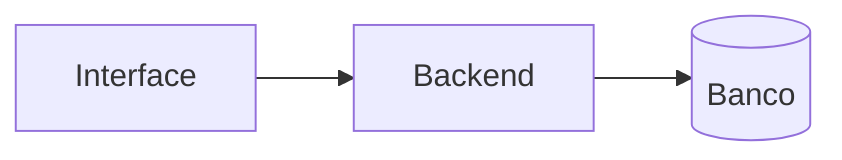

# Visão geral

## Resumo

<Uma ou duas frases: o que é o projeto, para quem e por quê.>

## Stack

| Camada | Escolha | ADR |
|---|---|---|
| Frontend | | |
| Backend | | |
| Persistência | | |

## Arquitetura

## Glossário

| Termo | Significado |
|---|---|
| | |
